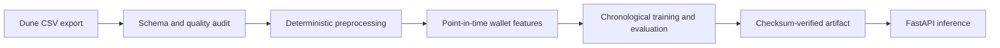
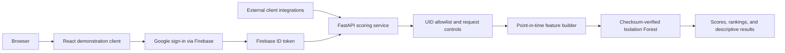

# Solana Wallet Risk

_Unsupervised Wallet Anomaly Detection on Solana_

Solana Wallet Risk analyzes user-supplied Solana decentralized exchange swap histories. It builds point-in-time wallet features, applies an unsupervised Isolation Forest, and returns non-probabilistic anomaly scores, ranked review candidates, and descriptive comparisons. Results identify statistically unusual activity and do not establish fraud.

## Live application

[**Open the Live Application**](https://solana-wallet-risk.web.app/#home)

The application uses Google sign-in. Protected analysis features require a verified account whose Firebase UID is approved by the service operator. Users supply transaction-history JSON; the application does not retrieve live blockchain history from a wallet address. On 19 November 2026, the live readiness endpoint reported checksum-verified experimental anomaly scoring as available and explicitly marked the output as non-probabilistic.

## API-first product architecture

The primary product is the FastAPI scoring service. External applications can submit validated JSON transaction histories, receive point-in-time wallet features, and request single-wallet or bounded batch anomaly analysis. JSON is the integration contract because it is structured, typed, and directly validated against the API schema. The React application is a demonstration client showing how a consumer can authenticate, submit supported histories, and visualize the response. A future SaaS offering could add customer and billing capabilities, but those features and live wallet-address data retrieval are not implemented.

## Key features

- Single-wallet and bounded multi-wallet analysis from supplied DEX event histories
- Isolation Forest anomaly scoring and within-batch ranking
- Analyst-selected review capacity and clearly marked review candidates
- Interactive score, feature, distribution, ranking, and wallet-detail views
- Strict point-in-time feature generation with 29 registered features
- Firebase Authentication and server-side UID authorization
- FastAPI model serving in a checksum-verified container
- React frontend hosted on Firebase and backend hosted on Google Cloud Run

## Technology stack

| Area | Technologies |
| --- | --- |
| Frontend | React, TypeScript, Vite |
| Backend | Python, FastAPI, Pydantic, Uvicorn |
| Data and ML | pandas, NumPy, scikit-learn, joblib |
| Authentication | Firebase Authentication, Firebase Admin SDK |
| Deployment | Docker, Artifact Registry, Google Cloud Run, Firebase Hosting |
| CI/CD | GitHub Actions, Google Workload Identity Federation |

## Dataset

**Data source: [Dune Analytics query 6561080](https://dune.com/queries/6561080)**

The dataset was extracted from Dune Analytics query 6561080 in multiple batches of approximately 1,000 rows. The query was executed again after the original extraction, so its currently visible SQL should not be treated as a preserved snapshot of the extraction-time query. The batches were combined as `nft.csv`, which contains 10,800 records covering January through November 2025. The preserved file has 1,000 rows for each month from January to March and May to November, plus 800 rows for April.

The 4.2 MB CSV remains excluded from Git because public redistribution permission for the result has not been established. The exact historical SQL revision, execution identifiers, parameters, extraction timestamps, and original batch files are not independently archived.

| Property | Verified value |
| --- | ---: |
| Source rows | 10,800 |
| Columns | 18 |
| Wallet identifiers | 2,312 |
| Transaction hashes | 9,221 |
| Observation period | 1 January to 30 November 2025 UTC |
| Retained events | 10,798 |
| Quarantined events | 2 |

Fields cover wallet, block time and slot, transaction hash, DEX, directional token information, amounts, USD value, fee, instruction indices, source, and supplied history fields. The cleaner preserves raw lineage, normalizes timestamps to UTC, applies formatting-only DEX normalization, retains missing fees as missing, retains large-value review flags, and quarantines two records with nonpositive required amounts.

The query URL and source identity are confirmed. Missing provenance evidence is limited to extraction-time metadata and data-sharing permission. See [data pipeline and provenance](docs/data_pipeline.md).

## Machine-learning pipeline



1. The audit verifies the expected 18-column schema, identifiers, timestamps, amounts, missingness, duplication, and event grain.
2. Preprocessing retains valid events, quarantines unsupported records with reason codes, preserves raw values, and sorts events deterministically.
3. Feature engineering aggregates each wallet only from events satisfying `block_time < as_of`.
4. Three cutoffs produce 1,754 training, 1,930 validation, and 2,312 holdout wallet snapshots. There are 5,996 snapshots in total.
5. Missing model inputs are imputed with medians learned from the training reference only. LOF also uses a training-fitted robust scaler.
6. Three unsupervised methods are fitted on the 1 September 2025 reference. October is used for exploratory validation and December for the final descriptive holdout.
7. The selected Isolation Forest, feature order, reference statistics, versions, and hashes are serialized to a local research bundle. A selected-model-only release artifact is published without LOF's retained row-level feature matrix.
8. FastAPI validates the artifact checksum and compatibility metadata before serving protected scoring requests.

## Models

| Model | Role | Verified comparison |
| --- | --- | --- |
| Isolation Forest | Selected application ranker | Stable validation rankings across tested tree and sample settings |
| Local Outlier Factor | Local-density comparator | More sensitive to neighbor choice and weakly aligned with the other holdout rankings |
| Robust median absolute deviation | Transparent baseline | Strong holdout rank agreement with Isolation Forest |

On the 2,312-wallet holdout, Spearman rank correlation was `0.8662` for Isolation Forest versus robust MAD, `0.0488` for Isolation Forest versus LOF, and `-0.0187` for LOF versus robust MAD. Isolation Forest validation sensitivity correlations ranged from `0.9923` to `0.9980`; LOF alternatives produced `0.6052` and `0.7827`. All three methods shared no top-10 wallets and seven top-100 wallets.

Isolation Forest was selected because its rankings were stable under the tested parameter variations and broadly agreed with the transparent robust baseline. These measurements compare ranking behavior only. They are not fraud-detection accuracy, and no verified fraud outcomes were available. See [model training and evaluation](docs/model_training_and_evaluation.md).

## Feature engineering

Each wallet snapshot contains 29 features grouped into:

- activity, frequency, and observed history
- USD volume and trade-size behavior
- timing, recency, and 24-hour, 7-day, and 30-day windows
- token and DEX diversity and concentration
- missingness and multi-instruction transaction context
- history coverage indicators

Wallet, transaction, and token identifiers are metadata, not direct model inputs. Strict cutoffs and training-only fitted transformations prevent future information from entering a score. The [feature registry](docs/feature_registry.md) defines every field and its lineage.

## Results

| Stage | Verified result |
| --- | --- |
| Data reconciliation | 10,800 input = 10,798 retained + 2 quarantined |
| Feature generation | 5,996 snapshots, 29 features, 3 chronological cutoffs |
| Training reference | 1,754 wallets at 1 September 2025 UTC |
| Validation | 1,930 wallets, including 176 later entrants |
| Holdout | 2,312 wallets, including 382 later entrants |
| Reproducibility | Two clean reruns produced byte-identical model and manifest files in the pinned environment |
| Selected ranker | Isolation Forest with 300 trees, `max_samples=256`, seed 42 |

All 1,754 training wallets occur again in later cumulative snapshots, so full-period comparisons are longitudinal diagnostics rather than wallet-independent tests. Synthetic demonstration data validates software behavior only and is not research outcome evidence.

## Application architecture



Cloud Run is reachable through its platform URL, while protected endpoints still require a valid Firebase ID token and an approved UID. Firebase authentication does not grant Cloud Run IAM access. The application enforces authorization inside FastAPI.

## Published model artifact

The versioned [4B.1 model release](artifacts/release/4B.1/) contains the fitted selected Isolation Forest, manifest, checksum list, aggregate feature-reference statistics, and loading instructions. It excludes the raw CSV, wallet identifiers, wallet snapshots, LOF's retained training matrix, and the robust comparison model.

| Artifact | SHA-256 |
| --- | --- |
| Public selected-model artifact | `de349dd2284db122ef528c03f0c61e7ab75f92ad002489399d074f554a61ebe5` |
| Public manifest | `e7c6188b6983650c6fecc002033ca3c70de9ef6f77e0395c5c6dccb99415bc13` |
| Private full research bundle | `3e35561b0bf5db42c5b7146e7ff568e313be1beb1be724997356af45f5533035` |

Verify and run deterministic synthetic inference:

```bash
(cd artifacts/release/4B.1 && sha256sum -c SHA256SUMS)
python scripts/demonstrate_batch_scoring.py \
  --artifact artifacts/release/4B.1/anomaly_models.joblib \
  --manifest artifacts/release/4B.1/anomaly_models_manifest.json \
  --sha256 de349dd2284db122ef528c03f0c61e7ab75f92ad002489399d074f554a61ebe5
```

Joblib uses pickle-compatible serialization. Load the artifact only from this trusted repository after verifying its checksum.

## Local setup

```bash
git clone https://github.com/Extreme-Ending/solana-wash-trading-detection.git
cd solana-wash-trading-detection
python3 -m venv .venv
source .venv/bin/activate
python -m pip install --upgrade pip
python -m pip install -e '.[dev]'
cp .env.example .env
```

Replace placeholders in the ignored `.env` file. Protected requests require the Firebase project ID, Application Default Credentials, and an approved UID. Do not put service-account keys in the repository.

Start the API:

```bash
set -a
source .env
set +a
uvicorn solana_risk.api.main:app --host 127.0.0.1 --port 8080
```

Start the frontend in another terminal:

```bash
cd frontend
cp .env.example .env.local
npm ci
npm run dev
```

Vite serves the frontend at `http://127.0.0.1:5173` and proxies `/api` to the local API on port 8080.

Run the main checks:

```bash
python -m pytest -q
npm --prefix frontend test -- --run
npm --prefix frontend run typecheck
npm --prefix frontend run build
docker compose config --quiet
```

## Reproduce the ML pipeline

Obtain the authorized reference export separately and place it at `nft.csv` in the repository root. It must match SHA-256 `8f387709c6742f2fc31c19fc32dac27474b6b27b9304786c367a8d8bece81271`. Query 6561080 may be rerun for a new dataset, but a later Dune execution is not expected to reproduce this historical file byte for byte. A different export requires a separately reviewed data contract.

```bash
python -m solana_risk.data.audit
python -m solana_risk.data.preprocess
python -m solana_risk.features.build \
  --as-of 2025-09-01T00:00:00Z \
  --as-of 2025-10-01T00:00:00Z \
  --as-of 2025-12-01T00:00:00Z
python -m solana_risk.models.train_anomaly
python -m solana_risk.models.evaluate_anomaly
sha256sum artifacts/experimental/anomaly_models.joblib
```

Run checksum-gated synthetic inference:

```bash
python scripts/demonstrate_batch_scoring.py \
  --artifact artifacts/experimental/anomaly_models.joblib \
  --manifest artifacts/experimental/anomaly_models_manifest.json \
  --sha256 "$(sha256sum artifacts/experimental/anomaly_models.joblib | cut -d' ' -f1)"
```

Generated data, pipeline reports, and the full research model bundle remain ignored. The selected-model-only release above is tracked for reviewer inference. See the [reproducibility guide](docs/reproducibility.md) for environment constraints.

## API

| Endpoint | Access | Purpose |
| --- | --- | --- |
| `GET /v1/health` | Public | Hosted application process health |
| `GET /healthz` | Local/container | Docker process health; Cloud Run external checks use `/v1/health` because paths ending in `z` can be reserved |
| `GET /readyz` | Public | Experimental scoring readiness |
| `POST /v1/features/preview` | Firebase token and approved UID | Build one 29-feature snapshot |
| `POST /v1/score` | Firebase token and approved UID | Score one supplied wallet history |
| `POST /v1/score/batch` | Firebase token and approved UID | Rank a bounded submitted wallet batch |

Production OpenAPI routes are disabled. Local development exposes Swagger at `http://127.0.0.1:8080/docs`, ReDoc at `http://127.0.0.1:8080/redoc`, and the schema at `http://127.0.0.1:8080/openapi.json`. Protected operations document the Firebase Bearer scheme without bypassing token verification or the UID allowlist. Request schemas, limits, error codes, and authentication behavior are documented in the [API contract](docs/api_contract.md).

Build and smoke-test the scoring-capable image from the public repository:

```bash
docker build -f Dockerfile.scoring -t solana-wallet-risk-api:4B.1 .
python scripts/container_smoke_test.py \
  --image solana-wallet-risk-api:4B.1 \
  --dockerfile Dockerfile.scoring \
  --expect-experimental-scoring
```

## Deployment

Firebase Hosting serves the static React application. Google Cloud Run runs the scoring container in `africa-south1`, using a checksum-pinned artifact packaged by `Dockerfile.scoring`. Artifact Registry stores container images. GitHub Actions runs tests and controlled Firebase releases through Workload Identity Federation. The tracked Cloud Run workflow remains a conservative model-disabled private-pilot path, while the current scoring release was performed through the guarded local deployment script. Long-lived Google Cloud keys are not stored in GitHub.

Deployment remains an operator-controlled action. See the [deployment guide](docs/deployment.md) for current architecture, release controls, and known operational issues.

## Limitations

- Anomaly scores are model-specific rankings, not fraud probabilities or confirmed wash-trading findings.
- No independently verified fraud outcomes are available for accuracy, precision, recall, or calibration evaluation.
- Results depend on the completeness and coverage of the supplied event history.
- The application does not retrieve live wallet histories from Solana.
- Dune query 6561080 is the confirmed source. Its exact historical SQL revision, execution identifiers, parameters, extraction timestamps, and data-sharing permission are not independently archived.

## Documentation

Start with the [documentation index](docs/README.md). It links to the authoritative data, feature, model, API, architecture, deployment, reproducibility, and limitation references. The final submission report is available as [PDF](reports/submission/solana_wallet_risk_project_report.pdf), [DOCX](reports/submission/solana_wallet_risk_project_report.docx), and [Markdown source](reports/submission/solana_wallet_risk_project_report.md). Historical milestone records remain in `docs/` for auditability but are not current operating instructions.

## Licence and data use

No public redistribution permission for the query result is established by this repository, so the raw Dune export remains excluded. The public selected-model artifact contains no raw events, wallet identifiers, wallet snapshots, or retained LOF training rows. The full research bundle remains private. Confirm applicable Dune terms, source-table conditions, and institutional requirements before sharing data-derived row-level material.
