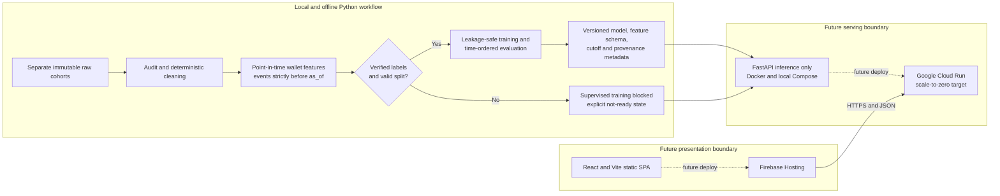

# Detecting Coordinated Wash Trading on Solana

This repository is the foundation for the DSA 8401 Applied Machine Learning capstone **“Detecting Coordinated Wash Trading on Solana: A Reproducible Wallet-Risk Scoring Service.”** The approved intent is to estimate wallet-level wash-trading risk at an explicit scoring time, rank wallets for human review, and provide defensible feature-level reasons using only information available before that time.

Phase 0 contains project metadata, architecture decisions, documentation, and a minimal testable Python package only. It does **not** contain data ingestion, preprocessing, feature engineering, model training, predictions, a backend API, a frontend, Docker assets, cloud resources, or evaluation results.

## Current evidence and blockers

The primary proposal and capstone-rubric PDFs are not present under a local `references/` directory. The current scope therefore follows the verified summaries in the local steering documents; those summaries are not a substitute for reading the primary documents when they become available.

The working tree also contains no raw datasets, so the earlier steering audit cannot yet be repeated. That audit reports that the supplied CSV schemas were DEX/swap-like event data with no explicit wallet-level wash-trading target. Before supervised modelling can begin, the project needs:

- a verifiable wallet label table with label meaning, source, version, review method, and knowledge timestamp;
- independently evidenced wallet-to-wallet edges before any coordination or graph feature is claimed;
- the actual on-chain provider/API, collection query, licence, snapshot details, and checksums;
- clarification of whether the intended domain is NFT marketplace sales or DEX swaps; and
- the proposal and rubric primary documents for direct traceability.

Until these conditions are met, no classifier, fraud probability, SHAP claim, or supervised metric is valid. An anomaly score, if explored later with approval, would remain descriptive and would not be presented as a wash-trading label or calibrated probability.

## Intended unit and scientific contract

The modelling unit is `(wallet, as_of)`. Future features must use events satisfying `block_time < as_of`. Wallets and transaction hashes are identifiers rather than predictors, supplied precomputed temporal fields require validation, and all fitted transforms must be learned inside training folds. The approved validation direction is chronological rather than a blindly copied random or group-only split.

## Approved architecture (future milestones, not yet implemented)

All assessed components will remain in this single repository, with clear boundaries between offline ML, serving, and the user interface:

- Python ingestion, audit, point-in-time features, training, evaluation, serialization, and shared inference transformations will live in the importable `src/solana_risk/` package and run locally.
- The future `api/` component will be a lightweight FastAPI application. Its Docker image will serve an already-created model artifact; it will never train on startup or during a prediction request.
- The future `frontend/` component will be a React + Vite static single-page application. It will communicate with the API over HTTPS/JSON using an environment-specific public API base URL.
- Local Docker/Compose operation will be established before cloud release. Google Cloud Run is the default future backend target and standard Firebase Hosting is the future frontend target. No cloud deployment is part of Phase 0.
- Core Python code will remain provider-neutral. Configuration will use environment variables, CORS will be restricted to the deployed Firebase origin and local development origin, and no credentials will be embedded in the frontend.



The graph above is a design target, not a deployment claim. When no verified model exists, the future backend must report an explicit not-ready state rather than return mock risk scores. A wallet-address-only lookup is also blocked until an authorized, timestamped event source or precomputed index is documented; the first valid inference interface may instead require validated event-history input with an explicit `as_of`.

Cost-conscious defaults for the eventual Cloud Run service are request-based CPU allocation, minimum instances set to zero, conservative maximum instances, CPU-only execution, measured memory, bounded requests, and no always-on database or paid blockchain RPC by default. Current regional pricing and all indirect costs must be checked immediately before any separately approved deployment.

Only the repository foundation exists in Phase 0.

## Repository layout

```text
README.md                  Project scope, constraints, setup, and milestone plan
AI_USE.md                  Factual disclosure of AI assistance
pyproject.toml             Minimal Python package and test configuration
src/solana_risk/           Importable package scaffold
tests/                     Scaffold-level tests only
docs/lab_traceability.md   Verified mapping to lecturer examples
docs/decision_log.md       Decisions and unresolved evidence requirements
```

Later approved milestones may add `api/` and `frontend/` as separately understandable components in the same repository. Those directories do not exist yet because neither application is a Phase 0 deliverable.

## Setup and scaffold check

Python 3.11 is the target baseline. Create an isolated environment and install the Phase 0 development dependency:

```bash
python3.11 -m venv .venv
source .venv/bin/activate
python -m pip install --upgrade pip
python -m pip install -e '.[dev]'
pytest -q
```

The current test checks only that the package scaffold imports and exposes its initial version. It is not evidence that any data or ML pipeline works.

## Student-operated Git helper

The executable `commit.sh` helper lets the student review, stage, commit, and push one genuine milestone interactively:

```bash
./commit.sh
```

Before first use, the student must configure their own real Git author identity. Repository-local configuration avoids changing unrelated repositories:

```bash
git config --local user.name "Your Name"
git config --local user.email "you@example.com"
```

Replace the placeholders with the name and email that should appear in the assessed Git history. The helper checks that both values exist but never sets them itself.

Run it personally from a terminal anywhere inside this repository. It displays the pending files, blocks steering instructions, secrets, raw datasets, and generated model artifacts, then asks before staging and again before committing. It runs Git’s staged-diff check and pushes the current branch without force; when no upstream exists, it sets `origin/<current-branch>` as the upstream.

The script intentionally stages all eligible working-tree changes after confirmation, so review its displayed file list carefully. Cancelling after staging leaves changes staged for the student to inspect. If a commit succeeds but pushing fails, the commit remains local; after resolving network or authentication issues, rerunning the helper detects the clean tree and offers to push the existing local commit. The helper does not amend, reset, rebase, bypass hooks, rewrite history, delete files, or store credentials.

## Planned gated milestones

1. **Phase 0 — foundation:** documentation, package scaffold, lab mapping, and test runner.
2. **Phase 1 — data integrity:** independently audit each supplied cohort, record hashes/provenance, and enforce label/edge readiness gates.
3. **Phase 2 — preprocessing:** implement deterministic parsing, ordering, invalid-row handling, and event-grain policy.
4. **Phase 3 — features:** build and test strict point-in-time wallet features.
5. **Phase 4 — supervised gate:** validate external labels; train and evaluate only if the gate passes.
6. **Phase 5 — local serving:** add honest readiness semantics, FastAPI, Docker/Compose, and smoke tests; do not deploy cloud resources.
7. **Phase 6 — submission evidence:** finalize architecture, model/data cards, report or slides, limitations, and reproducibility evidence.

React/Vite implementation, Firebase Hosting, Cloud Run deployment, and live integration tests are later, separately approved milestones. They will not be silently folded into the academic phases above.

Each phase stops for student review and a student-authored commit before the next begins.

## Course alignment

The initial mapping to the lecturer’s Lab 2, end-to-end practical, FastAPI, and MLOps examples is recorded in [`docs/lab_traceability.md`](docs/lab_traceability.md). Adaptations are explicit: the capstone uses wallet-level point-in-time observations, chronological validation, a no-label stop gate, and a fail-closed service rather than copying examples whose targets and deployment assumptions differ.

## Status

**Current phase:** Phase 0 — repository foundation and class-reference mapping.

**Model readiness:** blocked; no verified wallet-level labels are available in the current repository.

**Next action:** student review and explicit approval are required before Phase 1.
