# Application architecture

## System view

```mermaid
flowchart LR
    B[Browser] --> FH[Firebase Hosting]
    FH --> UI[React application]
    UI --> FA[Firebase Google sign-in]
    FA --> ID[Firebase ID token]
    ID --> CR[FastAPI on Cloud Run]
    CR --> AU[Token verification and UID allowlist]
    AU --> FB[Point-in-time feature builder]
    FB --> IF[Checksum-verified Isolation Forest]
    IF --> OUT[Analysis response]
```

## Frontend

The React application accepts one or more explicitly separated wallet histories as JSON. It validates input bounds, obtains a current Firebase ID token for protected requests, and renders score distributions, rankings, review candidates, feature comparisons, rejected inputs, and wallet details. Results remain in browser memory. The frontend does not query Solana by address.

Firebase Hosting serves the static Vite build. Local development uses Vite's `/api` proxy to `127.0.0.1:8080`.

## Authentication and authorization

Google sign-in is handled by Firebase Authentication. FastAPI verifies token signature, issuer, audience, subject, expiration, Firebase project identity, verified email status, and Google provider identity. It then enforces a server-side Firebase UID allowlist.

Firebase end-user tokens authenticate to FastAPI. They do not grant Google Cloud IAM permissions. The deployed Cloud Run service is platform-reachable so a browser can call it, while application endpoints remain protected by Firebase verification, UID authorization, CORS, request-size bounds, and rate limits.

## Backend

FastAPI exposes public health and readiness routes plus protected feature and scoring routes. Pydantic validates UTC timestamps, field types, event counts, and batch limits. Authentication occurs before protected work proceeds.

The feature service reuses the offline builder. It includes only records with `block_time < as_of`, excludes wallet identifiers from the feature vector, and returns the registered 29-feature order.

## Model serving

Training runs locally. The deployed scoring container packages the selected joblib bundle and manifest with `Dockerfile.scoring`. Startup fails closed if the checksum, feature order, registry fingerprint, training cutoff, package versions, or model metadata are incompatible.

The API performs no online fitting. It applies the stored training-median imputer and Isolation Forest to a newly built wallet snapshot. Batch ranking is deterministic within the submitted batch and does not define a universal fraud threshold.

## Deployment boundaries

- Firebase Hosting serves the public static frontend.
- Cloud Run hosts the FastAPI scoring container in `africa-south1`.
- Artifact Registry stores immutable Git-SHA-tagged images.
- Google Application Default Credentials support Firebase token-revocation checks.
- GitHub Actions uses Workload Identity Federation instead of stored Google Cloud keys.
- Raw research data and local model artifacts are not committed to Git.
