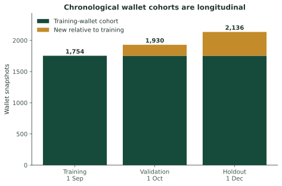
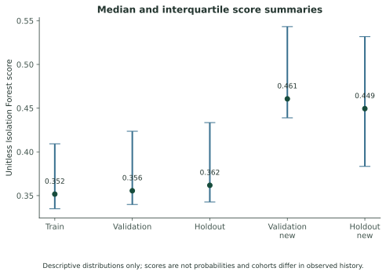
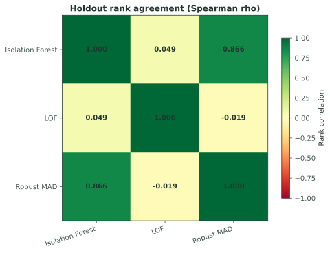
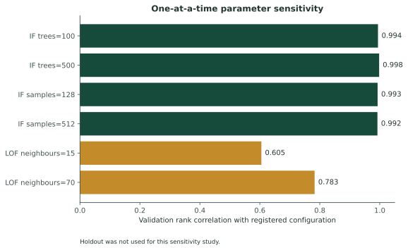
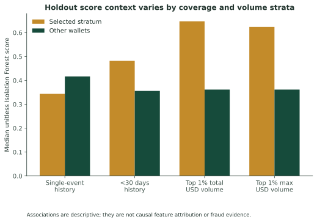

# Phase 9 research results

## Research scope

This section consolidates actual label-free experimental evidence for an MSc dissertation. The unit is `(wallet, as_of)` in the supplied Solana DEX/swap-event sample. Results describe unusualness relative to a fitted reference; they do not establish fraud, wash trading, coordination, intent or a probability of misconduct.

## Dataset and preprocessing

| Result | Verified value |
|---|---:|
| Supplied event rows | 10,800 |
| Unique wallet identifiers | 2,312 |
| Retained validated events | 10,798 |
| Quarantined records | 2 |
| Silently removed records | 0 |
| Time range | 1 January–30 November 2025 UTC |
| Registered features | 29 |
| Total point-in-time snapshots | 5,996 |

The schema supports DEX swaps, not NFT marketplace sales. Provider, collection query, sampling frame and licence remain unknown. Fee missingness and sparse wallet histories are material. The cleaner preserves missingness, reports invalid essential evidence, recomputes prior-event timing and does not create labels or graph edges.

## Feature engineering

Snapshots use only `block_time < as_of`. The three fixed cutoffs produce:

| Role | Cutoff | Prior events | Wallet snapshots |
|---|---|---:|---:|
| Training reference | 2025-09-01 UTC | 7,798 | 1,754 |
| Exploratory validation | 2025-10-01 UTC | 8,798 | 1,930 |
| Final descriptive holdout | 2025-12-01 UTC | 10,798 | 2,312 |

The 29 features cover activity/frequency, value distribution, recency/timing, recent windows, token/venue diversity, concentration, missingness/instruction context and observable-history coverage. Identifiers are metadata, supplied `source_week` is excluded, and no future event or outcome-derived field is used.

## Algorithms and selection rationale

- **Isolation Forest:** 300 trees, `max_samples=256`, `contamination="auto"`, all 29 features, seed 42. It is the locally served experimental ranker because its validation ranking was stable under the tested tree/sample alternatives.
- **Local Outlier Factor:** 35 neighbours with novelty scoring and robust scaling. It provides a local-density disagreement diagnostic but showed material neighbour sensitivity.
- **Robust median/MAD:** a transparent distance comparator with clipped deviations and explicit constant-feature handling.

All preprocessing is fitted on the September reference. `contamination="auto"` is an algorithm setting, not an estimate of fraud prevalence.

## Score distributions and cohort shift

Isolation Forest median scores were `0.3517` on training, `0.3556` on validation and `0.3618` on holdout. Later entrants had higher medians: `0.4606` in validation and `0.4494` in holdout. `observable_history_days` and `time_since_last_event_hours` exceeded one training IQR of median shift for new holdout wallets.

These differences may reflect shorter observable histories or cohort/regime differences. They are not evidence that later entrants are more fraudulent.

## Detector agreement

Holdout Spearman rank correlations were:

| Pair | Correlation |
|---|---:|
| Isolation Forest vs LOF | 0.0488 |
| Isolation Forest vs robust MAD | 0.8662 |
| LOF vs robust MAD | -0.0187 |

The detectors shared no wallet across all three top-10 lists. At top 100 they shared seven; pairwise Jaccard values remained between `0.0417` and `0.1976`. Candidate selection is therefore algorithm- and budget-dependent. Agreement cannot identify correctness without outcomes.

## Parameter sensitivity

The four predeclared Isolation Forest alternatives retained validation rank correlations from `0.9923` to `0.9980`. LOF neighbour alternatives produced `0.6052` and `0.7827`.

This supports the narrow statement that Isolation Forest ranking was stable within the tested local parameter range. It does not prove that the configuration is optimal or effective against fraud. The holdout was not used for this sensitivity comparison.

## Longitudinal and coverage evidence

All 1,754 training wallets recur in validation and holdout. Training-to-holdout rank correlations for those repeated wallets were `0.7502` for Isolation Forest, `0.2207` for LOF and `0.9635` for robust MAD. These measure longitudinal persistence as histories accumulate, not independent out-of-wallet generalisation.

Holdout median Isolation Forest scores also varied by descriptive strata:

- insufficient 30-day history: `0.4818` versus `0.3560` elsewhere;
- single-event history: `0.3438` versus `0.4165` for multi-event wallets;
- top 1% total volume: `0.6474` versus `0.3617`; and
- top 1% maximum event volume: `0.6245` versus `0.3617`.

These are associations, not per-feature model contributions or causal explanations.

## Demonstration cases

The repository contains constructed bursty, steady and sparse wallet histories. They verify input validation, strict cutoffs, finite scores, deterministic ranking and single/batch equality. They are intentionally named synthetic and are absent from training. Their scores must not be included as empirical cases or described as detected fraud.

No real wallet case study can be labelled a success or error because no independent outcome evidence exists.

## Threats to validity

1. Unknown source, selection mechanism, completeness and licence.
2. DEX data does not match the original NFT marketplace framing.
3. No independently verified outcome labels.
4. No wallet-to-wallet edges for coordination analysis.
5. Strong longitudinal dependence and sparse histories.
6. Later entrants differ in observable history.
7. Detector disagreement and arbitrary review budgets.
8. Repeated use of the December report would weaken its holdout role for future tuning.
9. Synthetic examples test software, not external validity.

## Defensible result

The project demonstrates a reproducible point-in-time anomaly-analysis and secure local delivery workflow. It does not demonstrate wash-trading detector effectiveness. Any future outcome claim requires lawful data provenance and independent timestamped labels from the same domain.
