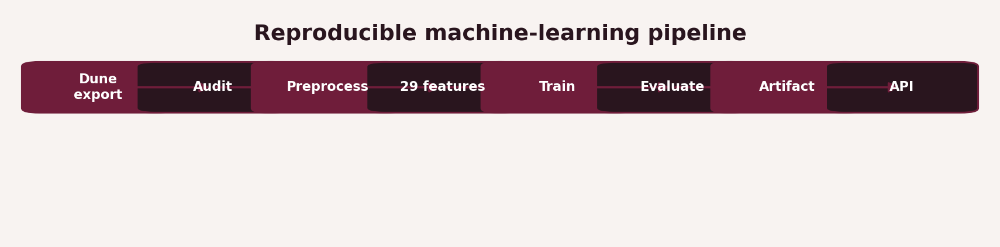
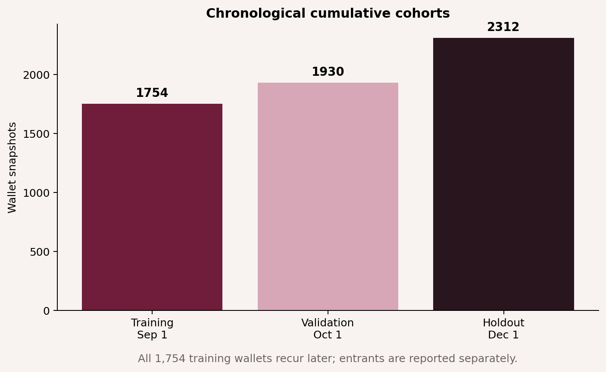
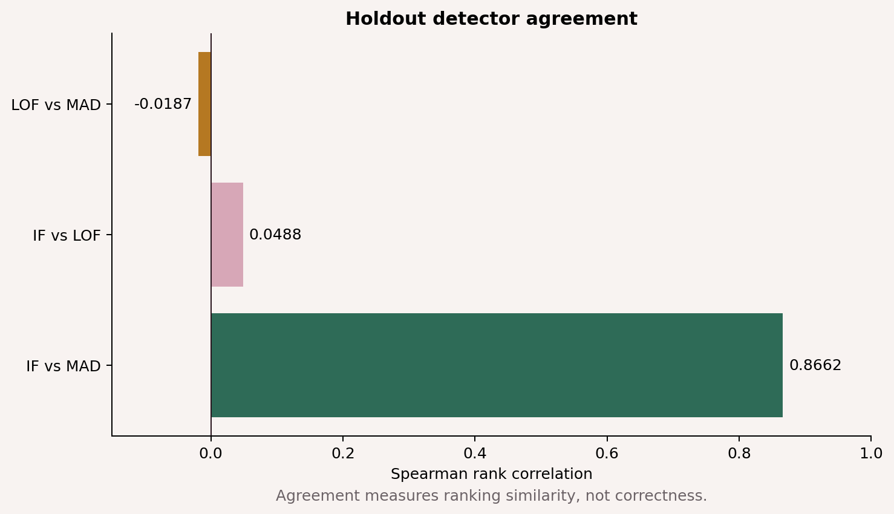
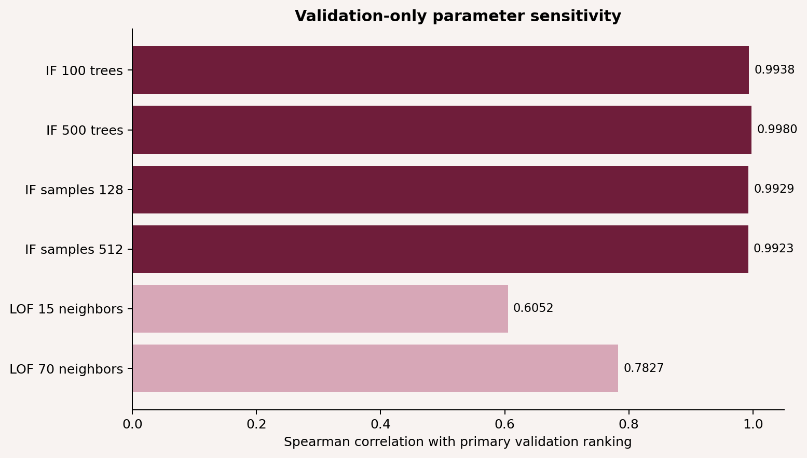
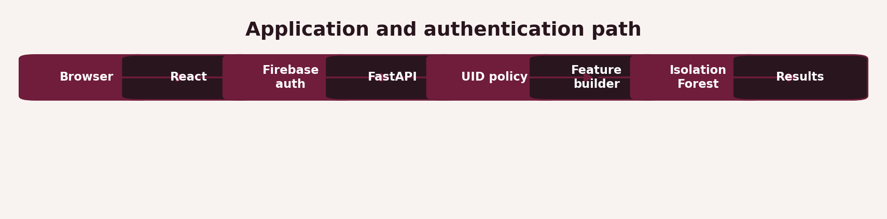

# Solana Wallet Risk

## Unsupervised Wallet Anomaly Detection on Solana

### Project report

| Report evidence | Value |
| --- | --- |
| Validated repository revision | `a3a2b795d7d5a3e589bcd66f6a1cddbe95fc53ac` |
| Validation date | 19 November 2026 |
| Live application | https://solana-wallet-risk.web.app/#home |

## Abstract

This project implements a reproducible system for ranking statistically unusual wallet activity in a supplied sample of Solana decentralized exchange swaps. The data, identified by the student as a Dune Analytics export, contains 10,800 event rows, 18 fields and 2,312 wallet identifiers between January and November 2025. It does not contain independently verified wash-trading outcomes or direct wallet-to-wallet counterparty evidence. The valid research task is therefore unsupervised anomaly analysis rather than supervised fraud classification.

The pipeline audits the source, quarantines unsupported records, creates 29 point-in-time wallet features and compares Isolation Forest, novelty Local Outlier Factor and a robust median absolute deviation baseline. Models are fitted on 1,754 wallet snapshots at 1 September 2025. October supports exploratory validation and December is a descriptive holdout. Isolation Forest was selected for application serving because its validation rankings were stable across tested settings and agreed strongly with the robust baseline. Holdout Spearman correlation was 0.8662 between Isolation Forest and robust MAD, but only 0.0488 between Isolation Forest and LOF. These results assess ranking stability and detector agreement, not fraud-detection accuracy.

The selected artifact is checksum-verified before FastAPI loads it. A React application on Firebase Hosting uses Google sign-in and sends Firebase ID tokens to a Cloud Run API that applies a server-side UID allowlist. The system returns anomaly scores, rankings and descriptive feature context. It does not return fraud probabilities or confirmed wash-trading findings. Major limitations are unresolved Dune query and licence evidence, sparse wallet histories, absent ground truth and incomplete clone-only data acquisition.

## 1. Introduction and problem definition

Public blockchain data provides timestamped transaction evidence, but observable transactions do not reveal intent or reliably identify the people controlling addresses. Wash trading is a particularly difficult construct because strong identification may require self-trade records, counterparty relationships, common-control evidence or independently adjudicated cases. Unusual volume, timing or concentration can also arise from legitimate activity.

The supplied project file contains DEX swap fields such as wallet, DEX, token pair, amounts, transaction hash and instruction indices. It does not contain NFT marketplace sale fields, independently verified outcomes or direct counterparty-wallet relationships. A supervised classifier trained from heuristic flags derived from the same behavioral variables would be circular and could produce misleading performance estimates.

The implemented problem is therefore narrower: can a reproducible point-in-time pipeline identify wallet observations that are statistically unusual relative to an earlier reference cohort, compare alternative anomaly concepts and deliver the results through a controlled review interface? The unit of analysis is `(wallet, as_of)`. A score describes relative unusualness for that unit and must not be interpreted as proof of misconduct.

## 2. Project objectives

The general objective is to design, implement and evaluate a reproducible unsupervised anomaly-analysis service for Solana DEX wallet activity.

The specific objectives are to:

1. audit and deterministically preprocess the event sample while preserving evidence and documenting provenance gaps;
2. construct leakage-safe wallet features from events strictly before explicit UTC scoring times;
3. compare Isolation Forest, LOF and robust MAD using label-free chronological diagnostics;
4. examine repeated-wallet dependence, later entrants and observable-history coverage;
5. serialize and validate a trusted model artifact with exact feature and dependency contracts; and
6. deliver bounded single-wallet and batch review through an authenticated web application.

The project does not attempt to prove coordinated trading, infer wallet ownership, automate adverse decisions or report supervised fraud metrics.

## 3. Dune Analytics dataset

The student identifies Dune Analytics as the source of the private CSV export. The exact Dune query URL or ID, SQL, extraction date, export procedure, sampling method, licence and redistribution permission are not present in the repository. This prevents independent reacquisition and means the raw file must not be published without further evidence.

| Property | Verified value |
| --- | ---: |
| Event rows | 10,800 |
| Columns | 18 |
| Wallet identifiers | 2,312 |
| Transaction hashes | 9,221 |
| Earliest event | 1 January 2025 00:42:47 UTC |
| Latest event | 30 November 2025 23:16:57 UTC |
| Source checksum | `8f387709...e81271` |

The fields describe wallet-attributed DEX swap observations. They include event time and slot, transaction hash, DEX, token pair and mints, input and output amounts, USD value, fee, instruction indices, source and supplied history fields. Source values are `dex_trade` and `jupiter_swap`.

Data quality issues include 7,303 missing fees, 2,322 missing supplied previous-event values and gaps, 936 missing instruction-index pairs, 39 missing token-pair display labels and two rows with nonpositive required amounts. There are no exact duplicate rows. Repeated transaction hashes are not assumed to be duplicates because one Solana transaction can contain several instructions.

## 4. Data preprocessing and quality

The audit runs before any treatment and records schema, missingness, identifier validity, timestamp parsing, amounts, category consistency and event grain. Sensitive identifier samples are hashed in reports. The source checksum is verified so a changed export fails rather than silently producing different results.

Preprocessing preserves every original field under a `raw__` prefix, attaches stable source-row lineage, parses timestamps to UTC and sorts deterministically by time, slot, transaction, instruction indices and source row. Formatting-only DEX normalization reduces case and punctuation variation while retaining differently named protocol variants as distinct values.

Missing fees remain missing and receive explicit indicators. The pipeline does not treat a missing fee as zero. The 1,099 large-value IQR flags remain unchanged because extreme values are not automatically errors. Two records with nonpositive required `amount_in` and `amount_usd` are quarantined with reason codes. No record is silently removed.

| Preprocessing result | Rows |
| --- | ---: |
| Input | 10,800 |
| Retained | 10,798 |
| Quarantined | 2 |
| Silently removed | 0 |

These choices adapt the lecturer's Applied Machine Learning lab pattern of inspecting missingness, duplicate grain, numeric validity and timestamps before treatment. They depart from simple transaction-ID deduplication because repeated Solana transaction hashes can represent legitimate multi-instruction events.



## 5. Feature engineering

The feature builder creates one row per wallet and scoring time. It first applies the strict boundary:

```text
block_time < as_of
```

Events exactly at or after the scoring time cannot affect the snapshot. Window features use closed-open 24-hour, 7-day and 30-day intervals. Supplied `prev_event_time`, `seconds_since_prev` and `source_week` are not trusted as model inputs; temporal behavior is recomputed from validated event times.

The 29 features cover activity and frequency, USD volume, recency and inter-event gaps, recent windows, token and DEX diversity, concentration, missing-fee context, multi-instruction transactions and observable-history coverage. Wallet, transaction and token identifiers are aggregation or audit keys, not direct predictors. Single-event histories retain unavailable gap statistics as missing.

Three cumulative cutoffs produce 5,996 snapshots:

| Role | Cutoff | Wallets | New relative to training |
| --- | --- | ---: | ---: |
| Training reference | 1 September 2025 | 1,754 | 0 |
| Exploratory validation | 1 October 2025 | 1,930 | 176 |
| Descriptive holdout | 1 December 2025 | 2,312 | 382 |

All 1,754 training wallets recur in later cumulative snapshots. Full-period comparisons are therefore longitudinal diagnostics. Later entrants are wallet-disjoint but have shorter observable histories and represent different acquisition cohorts.



## 6. Machine-learning methodology

All fitted preprocessing is learned from the September reference only. Each model uses training-median imputation. LOF additionally uses a `RobustScaler` fitted on training. Isolation Forest receives unscaled imputed values. Robust MAD learns training medians and median absolute deviations. The evaluator rejects all-missing training features, infinities, altered feature order, stale registry fingerprints and target-like fields.

The study uses chronological roles rather than a random row split. Validation sensitivity is calculated on October only. December is preserved for descriptive agreement, review-budget overlap, score distributions, repeated-wallet persistence, entrant shift and coverage diagnostics. The holdout is not used to select parameter alternatives.

With no verified outcome, the valid evaluation questions are:

- Are outputs deterministic under the pinned environment?
- Are rankings stable across reasonable parameter variations?
- How strongly do contrasting detectors agree?
- How does a fixed review budget change candidate overlap?
- How do history coverage and temporal cohorts affect score interpretation?

Precision, recall, F1, ROC-AUC, PR-AUC, calibration and confusion matrices are unavailable and are not estimated from pseudo-labels.

## 7. Models trained

### 7.1 Isolation Forest

The primary Isolation Forest uses 300 estimators, `max_samples=256`, `max_features=1.0`, `contamination="auto"`, no bootstrap, one job and random seed 42. It creates a nonlinear ranking by isolating observations through random feature partitions. The contamination setting is an algorithm configuration and does not estimate fraud prevalence.

### 7.2 Local Outlier Factor

The LOF pipeline uses 35 neighbors, Minkowski distance with `p=2`, novelty mode and robust scaling. Novelty mode permits scoring later observations. It provides a local-density perspective but proved sensitive to neighborhood size and weakly aligned with the other holdout rankings.

### 7.3 Robust MAD baseline

The robust baseline calculates clipped marginal deviations from training medians and MAD values, then combines them with a root-mean-square rule. It is transparent and handles zero dispersion explicitly. Correlated features can receive repeated influence, so it is a comparator rather than an outcome rule.

## 8. Model selection and evaluation

Isolation Forest validation rank correlations against the declared configuration ranged from 0.9923 to 0.9980 across alternatives with 100 or 500 trees and `max_samples` of 128 or 512. LOF correlations were 0.6052 with 15 neighbors and 0.7827 with 70 neighbors. The tested Isolation Forest ranking was therefore substantially more stable.

On the 2,312-wallet December holdout, pairwise Spearman correlations were:

| Pair | Correlation |
| --- | ---: |
| Isolation Forest and robust MAD | 0.8662 |
| Isolation Forest and LOF | 0.0488 |
| LOF and robust MAD | -0.0187 |



The three detectors shared no wallets in all top-10 lists, none in all top-25 lists, three in all top-50 lists and seven in all top-100 lists. Candidate selection is therefore detector- and budget-dependent. Agreement with robust MAD and high validation stability supported selecting Isolation Forest as the application ranker. This is an engineering selection for consistent review prioritization, not evidence that its top ranks are fraudulent.

Repeated-wallet reference-to-holdout rank correlations were 0.7502 for Isolation Forest, 0.2207 for LOF and 0.9635 for robust MAD. These values show longitudinal persistence as histories accumulate, not performance on independent wallets. Later entrants and incomplete-history groups show different score distributions, which makes coverage context essential.



## 9. Software architecture

The repository separates reusable research modules, tests, FastAPI, React and deployment configuration. Training runs locally and offline. The API does not fit models on startup or request. The same feature registry and `build_wallet_snapshots` function are used for offline training and online inference.

The serialized joblib bundle and sidecar manifest record feature order, registry checksum, snapshot checksum, training cutoff, model settings, random seed, reference summaries and library versions. The verified artifact SHA-256 is `3e35561b...f5533035`; the manifest SHA-256 is `1551d55f...061ad0`. Two clean runs in the pinned environment produced byte-identical files.



## 10. API and deployment

FastAPI exposes public health and readiness endpoints plus protected feature preview, single scoring and batch scoring. The protected routes accept user-supplied event histories and explicit UTC scoring times. They do not retrieve blockchain data from a wallet address.

Firebase Authentication supplies Google sign-in. The backend validates token signature, issuer, audience, expiration, Firebase project, subject, verified email, Google provider and revocation state. A server-side UID allowlist provides an additional authorization boundary. CORS, body-size limits, event and wallet limits, schema validation and per-instance rate limiting constrain requests.

The React frontend is hosted at https://solana-wallet-risk.web.app/#home. The backend runs on Cloud Run in `africa-south1`. Read-only inspection on 19 November 2026 confirmed revision `solana-wallet-risk-api-00007-4mh` at 100% traffic, one CPU, 512 MiB memory and the dedicated runtime identity. `/v1/health` and `/readyz` returned HTTP 200. Readiness reported `experimental_anomaly_scoring` and `is_probability=false`, confirming that startup artifact validation passed. Protected endpoints returned HTTP 401 without a token.

The live `/healthz` route returned a Google-edge HTTP 404 although the same route works in local containers. Cloud Run documents that some paths ending in `z` are reserved, and the deployed service uses a TCP startup probe rather than this HTTP path. External monitoring therefore uses the working `/v1/health` route; no ingress or authentication change is required. An authenticated numerical response was not independently captured for this report because no Firebase user token was supplied to the verification process. The repository provides a secure manual acceptance script that reads a token from an environment variable without storing or printing it.

## 11. Results and discussion

The strongest result is end-to-end engineering reproducibility under a fixed private input and pinned environment. Audit, cleaning, point-in-time features, model fitting, artifact serialization, evaluation and synthetic prediction can be rerun with exact counts and hashes. Train-time and serve-time feature parity is enforced by shared code and tests.

The detector comparison shows why anomaly output needs careful interpretation. Isolation Forest and robust MAD agree strongly on the broad holdout ranking, while LOF offers a substantially different local-density view. No detector has verified outcome evidence. The absence of common top-10 observations demonstrates that operational review queues depend on algorithm and budget choices.

Temporal design also exposes limitations that a random split would hide. Repeated wallets create dependent cumulative observations, while later entrants are independent identities with shorter histories and shifted coverage. A high score can reflect amount extremes, incomplete history, unusual concentration or other divergence from the reference. None of these mechanisms alone proves manipulation.

The web application makes these boundaries visible. It displays model-specific values without percentage formatting, separates score, rank and review-budget markers, and presents feature comparisons as descriptive context rather than SHAP or causal attribution. Synthetic examples exercise the software but are never presented as empirical cases.

## 12. Limitations and ethics

The exact Dune query, extraction process, sample construction, extraction date, licence and redistribution conditions are unresolved. This is the main reproducibility and governance blocker. The checksum proves local file identity but not lawful origin, completeness or public reuse rights.

No independently verified fraud or wash-trading outcomes exist. Detection accuracy cannot be measured. The schema contains no direct counterparty or common-control evidence, so graph coordination claims are disabled. Histories are sparse, most wallets appear in one event month, feature groups contain correlated variables and the study covers one sample and one period.

Wallet addresses are pseudonymous behavioral identifiers. Publishing ranked addresses with allegations could create reputational harm. The system is designed for controlled research review, not deanonymization, sanctions or automated enforcement. Independent evidence and due process are necessary before any external action.

## 13. Conclusion and future improvements

Solana Wallet Risk demonstrates that an unlabelled DEX sample can support a rigorous, reproducible anomaly-analysis workflow when claims remain aligned with the evidence. The project combines conservative data treatment, strict temporal cutoffs, comparative unsupervised modelling, integrity-bound artifacts, typed API serving and authenticated review delivery.

Isolation Forest is the current application ranker because it was the most stable tested nonlinear method and aligned strongly with the transparent robust baseline. The result is a relative anomaly score and review ranking, not a fraud probability.

Priority future work is to recover the exact Dune query and use rights, obtain an independent later cohort, predeclare broader feature and seed sensitivity analyses, and secure expert timestamped review outcomes. Verified outcomes could support a separately approved effectiveness study. Direct counterparty and ownership evidence would be required before coordination analysis.

## 14. Reproducibility and handover

The complete local pipeline is:

```bash
python -m solana_risk.data.audit
python -m solana_risk.data.preprocess
python -m solana_risk.features.build \
  --as-of 2025-09-01T00:00:00Z \
  --as-of 2025-10-01T00:00:00Z \
  --as-of 2025-12-01T00:00:00Z
python -m solana_risk.models.train_anomaly
python -m solana_risk.models.evaluate_anomaly
```

The source CSV and model binary are excluded from Git. Full computation requires the authorized source matching checksum `8f387709...e81271`. The reviewer model package can be built with `python scripts/package_model_artifact.py` after the lecturer confirms an acceptable distribution channel. Joblib files must be loaded only from a trusted source.

## References

Breunig, M. M., Kriegel, H.-P., Ng, R. T., and Sander, J. (2000). LOF: Identifying density-based local outliers. *Proceedings of the ACM SIGMOD International Conference on Management of Data*, 93–104. https://doi.org/10.1145/342009.335388

Campos, G. O., Zimek, A., Sander, J., Campello, R. J. G. B., Micenková, B., Schubert, E., Assent, I., and Houle, M. E. (2016). On the evaluation of unsupervised outlier detection. *Data Mining and Knowledge Discovery, 30*(4), 891–927. https://doi.org/10.1007/s10618-015-0444-8

Chandola, V., Banerjee, A., and Kumar, V. (2009). Anomaly detection: A survey. *ACM Computing Surveys, 41*(3), Article 15. https://doi.org/10.1145/1541880.1541882

Dune Analytics. (n.d.). *Dune Analytics*. https://dune.com/

Gama, J., Žliobaitė, I., Bifet, A., Pechenizkiy, M., and Bouchachia, A. (2014). A survey on concept drift adaptation. *ACM Computing Surveys, 46*(4), Article 44. https://doi.org/10.1145/2523813

Goldstein, M., and Uchida, S. (2016). A comparative evaluation of unsupervised anomaly detection algorithms for multivariate data. *PLOS ONE, 11*(4), e0152173. https://doi.org/10.1371/journal.pone.0152173

Hilal, W., Gadsden, S. A., and Yawney, J. (2022). Financial fraud: A review of anomaly detection techniques and recent advances. *Expert Systems with Applications, 193*, 116429. https://doi.org/10.1016/j.eswa.2021.116429

Liu, F. T., Ting, K. M., and Zhou, Z.-H. (2008). Isolation forest. *2008 Eighth IEEE International Conference on Data Mining*, 413–422. https://doi.org/10.1109/ICDM.2008.17

Pimentel, M. A. F., Clifton, D. A., Clifton, L., and Tarassenko, L. (2014). A review of novelty detection. *Signal Processing, 99*, 215–249. https://doi.org/10.1016/j.sigpro.2013.12.026

Pineau, J., Vincent-Lamarre, P., Sinha, K., Larivière, V., Beygelzimer, A., d'Alché-Buc, F., Fox, E., and Larochelle, H. (2021). Improving reproducibility in machine learning research. *Journal of Machine Learning Research, 22*(164), 1–20. https://www.jmlr.org/papers/v22/20-303.html

Rousseeuw, P. J., and Croux, C. (1993). Alternatives to the median absolute deviation. *Journal of the American Statistical Association, 88*(424), 1273–1283. https://doi.org/10.1080/01621459.1993.10476408

Rudin, C. (2019). Stop explaining black box machine learning models for high stakes decisions and use interpretable models instead. *Nature Machine Intelligence, 1*, 206–215. https://doi.org/10.1038/s42256-019-0048-x

Victor, F. (2020). Address clustering heuristics for Ethereum. In *Financial Cryptography and Data Security*, 617–633. https://doi.org/10.1007/978-3-030-51280-4_33

Victor, F., and Weintraud, A. M. (2021). Detecting and quantifying wash trading on decentralized cryptocurrency exchanges. *Proceedings of the Web Conference 2021*, 23–32. https://doi.org/10.1145/3442381.3449824
